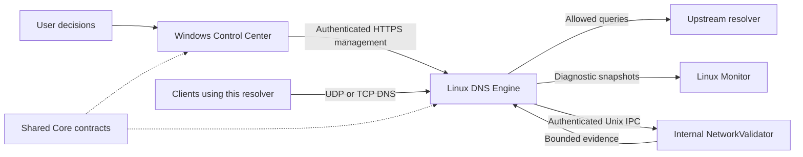

# HostsGuardian

**[English](README.md) | [Magyar](README.hu.md)**

A C#/.NET DNS policy project with a Windows WPF Control Center, Linux DNS Engine and Linux diagnostics Monitor.

> **Pre-1.0 development candidate, based on v0.4.0.** Historical global DNS Block/Restore evidence is recorded below. Current source has local regression coverage, not new production acceptance. Reliable device-specific enforcement and complete LAN coverage remain unproven.

Publication preparation: **28 October 2026**. This working-tree candidate has no new commit, tag, binary release or deployment. [Verification and version provenance](docs/publication-verification-2026-10-28.md) separates source tests from historical runtime evidence.

## Project overview and architecture

**Engine executes. Monitor observes. WPF decides.** Registration, presence, validated identity, policy delivery, DNS response and application blocking are separate states.



WPF owns device registration, friendly names/types and user decisions. Monitor consumes identity/policy read-only. NetworkValidator is a constrained internal helper, not a fourth control plane. DNS traffic does not pass through WPF; systemd owns the independent Engine lifecycle.

**The Engine is currently a DNS server, not a mandatory gateway for every LAN client.** Configured DNS is not proof of observed DNS. DNS filtering cannot guarantee termination of existing connections or prevent alternate resolvers, encrypted DNS and cached answers.

## Current capabilities

| Capability | Status |
|---|---|
| WPF startup, Domains/Devices, EN/HU | Historical human review of a selected package; current WPF fixture regressions pass. |
| Global WPF Block → real DNS sinkhole → Restore | VERIFIED on 13 October 2026; evidence below. |
| IPv4/IPv6 UDP/TCP listeners and upstream forwarding | IMPLEMENTED, with prior deployment/readiness evidence; not whole-LAN coverage. |
| Registry, names/types, device policy | IMPLEMENTED; reliable selective live enforcement PARTIAL / UNVERIFIED. |
| DeviceId binding, passive evidence, TTL/conflicts | IMPLEMENTED; production freshness/receiver limitations are KNOWN ISSUES. |
| Revision/CAS, Safe Mode, persistence | IMPLEMENTED, with regression and prior runtime evidence. |
| Groups/profiles/schedules/service catalog | IMPLEMENTED contracts/evaluator; complete real-device acceptance UNVERIFIED. |
| Notifications/audit/structured logging | IMPLEMENTED / PARTIAL; records alone do not prove native delivery. |
| Monitor blocked-query data channel | VERIFIED for the global test; GUI event rendering UNVERIFIED. |
| Receiver recovery and bounded refresh | Included with generation/timeout/cancellation regressions; production acceptance pending. |
| Correlated DNS diagnostics | Included: 512 queued events, 2048 decisions, 15-minute monotonic retention, loss counters; local socket-write success is not client receipt. |
| Exact device-rule Restore and settings synchronization | Included with persisted ABSENT/Inherit/Allow/Block restoration and mocked WPF tests; delivery remains explicit. |
| Guarded upgrade and recovery tooling | Included with isolated tests; root/PID1, hard-kill and reboot acceptance pending. |
| Whole-LAN / Network Enforcement | BLOCKED: resolver coverage and mandatory traffic chokepoint are unproven. |

Detailed source/test references and preserved concepts: [Architecture and roadmap](docs/ARCHITECTURE_AND_ROADMAP.md).

## Technical stack and implemented design

.NET 8/C#, WPF, custom DNS/HTTPS Engine; Python GTK/PyGObject/Cairo Monitor; systemd service/socket activation; console regression harnesses and Python unittest.

- Immutable policy snapshots and CAS revisions: [EnginePolicyState](HostsGuardian.DnsEngine/EnginePolicyState.cs), [PolicyApplicationService](HostsGuardian.DnsEngine/PolicyApplicationService.cs).
- Deterministic specificity: Device override → active profile/schedule → group → global; Block wins same-level conflicts: [PolicyDecision](HostsGuardian.Core/Services/PolicyDecision.cs).
- Normalized exact and dot-delimited subdomain matching: [DevicePolicyEvaluator](HostsGuardian.DnsEngine/DevicePolicyEvaluator.cs).
- Bounded DNS concurrency/timeouts: [DnsProxyServer](HostsGuardian.DnsEngine/DnsProxyServer.cs), [DnsRequestProcessor](HostsGuardian.DnsEngine/DnsRequestProcessor.cs).
- Evidence-based identity rejects stale/ambiguous claims rather than trusting historical IPs: [AddressBindingStore](HostsGuardian.DnsEngine/AddressBindingStore.cs).

Adaptive Simple/Indexed switching, learning service discovery and SQLite/WAL aggregation are not claimed as implemented. Fixed immutable address/scope indexes and bounded diagnostic queues are included in this source candidate.

## Historical end-to-end DNS blocking

The previous documentation records the following controlled Windows-to-Linux Engine test for `example.com` on **13 October 2026**. It was not rerun during this publication review and does not identify the current candidate as the deployed build:

| Stage | Observed result |
|---|---|
| Baseline | NOERROR, A answers `104.20.23.154`, `172.66.147.243`. |
| WPF Domains Block, revision 46 | NOERROR, A sinkhole `0.0.0.0`, TTL 60. |
| Monitor data | GlobalBlock and blocked query recorded; source DeviceId Unknown. |
| WPF Restore, revision 47 | Normal A answers returned; original policy semantics restored. |

The user also reported successful browser blocking on a Lenovo laptop and mobile through Domains. These are human observations, not captured per-device acceptance. Revision increments change serialized policy hashes; restoration preserves original policy content apart from expected revision metadata.

This proves global filtering for requests reaching the Engine. It does **not** prove Devices-tab enforcement, reliable automatic identity, whole-LAN coverage, DoH resistance or Monitor GUI rendering.

## Installation, configuration, running and tests

Review the historical repository deployment instructions against the intended release before privileged installation. [Monitor guide](linux-monitor/README.md). Keep credentials, certificates and machine-specific configuration outside Git. Configure WPF through supported authenticated HTTPS enrollment; local draft edits and explicit Engine delivery are distinct. Clients must actually select this resolver. Documentation does not authorize network changes.

Windows development requires .NET 8 SDK/WPF support:

```powershell
dotnet build HostsGuardian.sln -c Release
dotnet run --project HostsGuardian.Wpf -c Release
dotnet run --project HostsGuardian.RegressionTests -c Release
dotnet run --project HostsGuardian.Wpf.RegressionTests -c Release
```

Run `python3 -B -m unittest discover -v` separately in `network-validator`, `linux-monitor` and `development/roadmap`. GTK tests require Linux graphical dependencies; platform skips are not executed GUI tests. A new development build is not automatically an accepted release artifact.

The current Windows verification matrix, exact commands, skips and source-provenance limits are in [Publication verification](docs/publication-verification-2026-10-28.md). Core/Engine: **332 passing groups**; WPF: **39 PASS messages**, exit 0. Python results are reported as executed/pass/skip counts, rather than treating GTK skips as GUI success. Older Linux and candidate results remain historical evidence in milestone documents.

Recovery scripts are maintained source, not disposable disk images. Generated private sessions, credentials, certificates, build output and recovery images stay outside Git. The transfer bootstrap defaults to `/var/tmp/hostsguardian-transfer`; package generators can explicitly provide `transferDirectory`. Generating a bootstrap never authorizes or performs deployment.

## Security model and limitations

Authenticated HTTPS/certificate enrollment, revision/instance CAS, root/PID1-controlled socket paths and peer/live-process authorization protect management and IPC. Engine retains CAP_NET_BIND_SERVICE; only constrained NetworkValidator may receive CAP_NET_RAW through its service. Passive MAC evidence is not cryptographic identity and cannot exclude complete IP/MAC impersonation.

Stale neighbours do not prove online state. Registration, GUI toggles, saved drafts and successful API responses alone do not prove enforcement.

## Known issues and roadmap

1. **P0 — Devices:** reliable attribution, selective two-client Block/Restore, freshness/receiver races, truthful WPF enforceability.
2. **P1 — Network topology:** router/gateway options, IPv4/IPv6, alternate DNS/DoH coverage, vendor-independent evidence and mandatory chokepoint.
3. **P2 — Observability:** graphical block events, request/identity/revision/response correlation, retention and audit.
4. **P3 — Release management:** one official WPF package, reproducible manifests, retention/cleanup.

IPv6 per-device attribution, native notification/schedule acceptance, populated device-policy coverage and generic production recovery remain incompletely proven. Natural traffic/incidents provide opportunistic evidence. Historical systemd reload caveats require actual deployment review; this publication changes no runtime state.

## Project status

**Work in progress.** Historical global DNS filtering is documented; reliable general device enforcement is the next acceptance objective. This publication preparation creates no deployment, tag or binary GitHub release. Application code uses the repository MIT license; embedded fonts retain their separate [Orbitron](HostsGuardian.Wpf/Assets/Fonts/OFL.txt) and [Exo](HostsGuardian.Wpf/Assets/Fonts/Exo-OFL.txt) notices.
